# Mistral T3

<p align="center">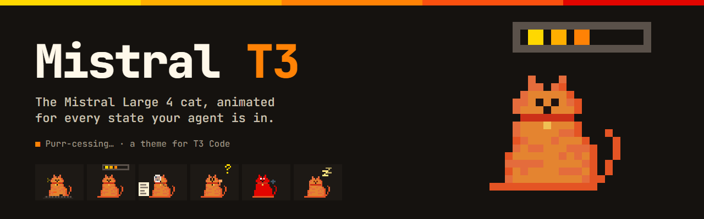</p>

<p align="center">
  <a href="https://github.com/heylyfe/mistral-t3/releases"></a>
  <a href="https://github.com/heylyfe/mistral-t3/actions/workflows/test.yml"></a>
  
  <a href="LICENSE"></a>
</p>

A [T3 Code](https://github.com/pingdotgg/t3code) theme in the Mistral rainbow, with an animated pixel cat (the Mistral Large 4 cat, collar and bell included) that plays a different animation for each state your agent is in.

> **Beta.** Tested against T3 Code's own theme checks, but it hasn't had much use in the real app yet. If a cat lands in the wrong place, please [open an issue](../../issues/new/choose) with a screenshot.

**Contents:** [The cats](#the-cats) · [Where they show up](#where-they-show-up) · [The theme](#the-theme) · [Install](#install) · [Troubleshooting](#troubleshooting) · [Make it your own](#make-it-your-own) · [Credits](#credits) · [Changelog](CHANGELOG.md)

## The cats

| | | | |
| :---: | :---: | :---: | :---: |
| <br>**Idle**<br><sub>breathes, blinks, tail sways</sub> | <br>**Thinking**<br><sub>a rainbow loading bar fills</sub> | <br>**Working**<br><sub>types, bell jingles, code flies</sub> | <br>**Reading**<br><sub>magnifier sweeps the files</sub> |
| <br>**Delegating**<br><sub>tiny cats crouch and pounce away</sub> | <br>**Subagent**<br><sub>a tiny cat, hopping</sub> | <br>**Waiting**<br><sub>waves, holds up a “?”</sub> | <br>**Error**<br><sub>flashes red, X eyes, sweats</sub> |
| <br>**Done**<br><sub>cheering hop, confetti</sub> | <br>**Sleeping**<br><sub>eyes shut, Zzz</sub> | <br>**Compacting**<br><sub>kneads the conversation down</sub> | <br>**Terminal**<br><sub>runs a command in a tiny shell</sub> |
| <br>**Editing**<br><sub>knocks the old line off the table</sub> | <br>**Browsing**<br><sub>globe spins, mistral wind blows</sub> | <br>**Planning**<br><sub>ticks off a checklist</sub> | <br>**Listening**<br><sub>watches you type, “…” bubble</sub> |
| <br>**Grooming**<br><sub>licks a paw between turns</sub> | <br>**Le gros chaton**<br><sub>extra chonk, with a croissant</sub> | <br>**Painting**<br><sub>paints the rainbow (Appearance settings)</sub> |  <br>**Peek & paw**<br><sub>for hovering and dragging chats</sub> |

21 sprites, each a single SVG of 1–6 KB, drawn as true pixel art: every frame is whole pixels, and motion is either a whole-pixel jump or a swap between hand-drawn frames. The animation is CSS inside the SVG: no GIFs, no JavaScript. With reduced motion turned on in your system, every cat holds still. Download [`gallery.html`](gallery.html) and open it in a browser for a closer look.

## Where they show up

- **On the message box:** a big cat sits on top of the chat input and follows the open thread. It types while the agent works, thinks while it reasons, reads during file reads and searches, runs commands in a tiny terminal, knocks lines off the table during edits, rides the mistral wind during web searches, ticks a checklist while planning and sends tiny cats pouncing out left and right while subagents run. It waves for approvals, flashes red on errors and perks its ears while you type.
- **After a turn:** it cheers, sits, grooms a paw, turns into *le gros chaton*, then falls asleep (about 3 minutes in all).
- **Beside "Working for 12s":** a small typing cat, which kneads while the context is compacted.
- **Beside each running subagent:** a tiny cream cat with an orange collar.
- **In an empty chat:** a tiny cat walks along the top of the message box towards the big cat.
- **In the sidebar:** each thread gets a cat for its status (working, waiting, error, done or asleep). Hover a chat and the status cat steps aside while a tiny cat peeks up from under the row.
- **Moving and settling chats:** drag a chat (or sweep across several) and the cat's paw bats at it. Drop it on **Settle** and a second paw swipes in from the other side, and the "Settled, Undo" notice gets one last swipe.
- **In Settings:** a kitten sits on the section you're in, a tiny cat peeks out of the others when you hover them, and a cat in the corner of the page matches the section: it paints the Mistral rainbow on Appearance, types on Keybindings, sends tiny cats off on Providers, naps on Archived and turns into *le gros chaton* on About.

## The theme

- **Palette:** dark mode is warm black with cream text and Mistral orange (`#FF8205`). Light mode sits on Mistral's cream (`#FFFAEB`) with dark orange (`#FA500F`).
- **The Mistral rainbow** (`#FFD800 #FFAF00 #FF8205 #FA500F #E10500`, the bands of the pixel logo): a **VIBE** tag next to the T3 logo, a thin edge on the sidebar, and a rule on top of the message box.
- A square orange send button with a red pixel shadow, and monospace code.

## Install

You need a **T3 Code nightly from 14 Nov 2026 or later**. Earlier versions cap theme CSS at 20,000 characters; this theme uses about 82,000 (the limit is now 100,000).

**In the app:** download `t3-mistral.json` from the [latest release](../../releases), open **Settings → Appearance → Add a theme**, drop the file in, and pick **Mistral T3**.

**From the terminal:**

```sh
t3 theme set ./t3-mistral.json   # undo with: t3 theme clear
```

**Updating:** add the new `t3-mistral.json` the same way and choose **Update existing**.

**Only want the cats?** [`cats/mistral-cats.css`](cats/mistral-cats.css) defines the 18 sprites as `--mc-<state>` variables, and [`cats/mistral-cats-mod.css`](cats/mistral-cats-mod.css) adds the placement rules without the Mistral styling, so you can add them to any theme:

```css
.my-thing { background: var(--mc-working) center / contain no-repeat; }
```

## Troubleshooting

| Problem | Fix |
| --- | --- |
| The theme won't import, or the CSS is too long | Update to a T3 Code nightly from 14 Nov 2026 or later. |
| A cat shows the wrong state or sits in the wrong place | A T3 Code update probably changed the page. [Open an issue](../../issues/new/choose) with your version and a screenshot. |
| The cats don't move | Your system is set to reduce motion, and the cats respect that. |
| No cats in the sidebar | Sidebar cats match English status words, so they don't show in other languages. |
| The big cat covers something | Change its size or position in [`src/mod.css`](src/mod.css) and run `npm run build`. |

## Make it your own

Everything is generated by one script with no dependencies (Node 20+):

```sh
npm run build   # draws every cat, writes the SVGs, CSS, theme and gallery
npm test        # checks the result the way T3 Code does
npm run preview # writes mock-preview.html: a fake T3 Code window for every situation
```

`npm test` runs two sets of checks with Node's built-in test runner (nothing to install):

- **Theme file:** T3 Code's theme schema and 100k limit, T3 Code's own CSS filter (copied into `test/t3/`), self-contained SVGs, and a fresh build matching the committed files.
- **Real browser:** a headless Chrome or Edge loads a fake T3 Code page, applies the theme with T3 Code's own loader, and checks which cat shows in 35 situations: every tool, approvals, questions, errors, which state wins, typing, every sidebar status, dragging and settling chats, and the settings pages. Skipped if no Chrome or Edge is found (set `CHROME_PATH`).

| File | What it holds |
| --- | --- |
| [`build.mjs`](build.mjs) | the cat's pixel map, every animation, the palettes |
| [`src/mod.css`](src/mod.css) | where the cats appear and which state wins |
| [`src/look.css`](src/look.css) | the Mistral styling |
| [`src/gallery.html`](src/gallery.html) | the gallery page |

The cat is traced as a letter grid at the top of `build.mjs` (`MAP`), one letter per pixel, so you can redraw it by editing text.

**How it works:** T3 Code themes are CSS only, so every sprite is a `data:` URI in a CSS variable. The CSS reads state from attributes T3 Code already renders (`data-timeline-row-kind`, `data-v2-item-type`, the sidebar's `aria-label`, the lucide icon of the running tool), and `body:has(...)` rules pick the cat. They're wrapped in `:where()` so the more urgent state, written later, wins.

**Known limits:** only T3 Code's documented hooks are guaranteed; the tool icons, sidebar status words, the drag badge and the undo notice's classes may change in an update. Works on web and desktop; T3 Code mobile doesn't use themes.

### Contributing

Ideas for new cats are welcome: [suggest one](../../issues/new/choose). For a PR, change `build.mjs` or `src/`, run `npm run build` and `npm test`, commit the generated files, and add a line to [CHANGELOG.md](CHANGELOG.md).

### Releasing

Bump `version` in `package.json`, add a section to `CHANGELOG.md`, run `npm run build`, commit, and push a tag like `v1.0.0`. The [release workflow](.github/workflows/release.yml) tests, then publishes the release with `t3-mistral.json`, the gallery, a zip of the cats and checksums. Tags with a `-` (like `v1.0.0-beta.1`) become pre-releases.

## Credits

- **The cat** is the Mistral Large 4 cat, redrawn as an 18×15 pixel grid. The Vibe CLI's welcome cat, *petit chat*, and its chonky *LeChonk* variant in [mistralai/mistral-vibe](https://github.com/mistralai/mistral-vibe) inspired the idea. The thinking bar is a nod to Vibe's ■ pulse spinner.
- **Le gros chaton** comes from the "Le Chaton Fat" meme that Mistral's CEO played along with.
- [`test/t3/`](test/t3) holds T3 Code's own theme filter ([MIT](test/t3/LICENSE), © T3 Tools Inc.), so the tests check what the app checks.
- Unofficial fan project, not affiliated with Mistral AI or T3 Tools. Mistral, Le Chat and Vibe are trademarks of Mistral AI.

## License

[MIT](LICENSE). The files in `test/t3/` keep their own MIT license.
